# PingTools — Network Utilities

A pure **Cupertino Flutter** network toolkit for Android, rebuilt from the native v1 app. Ten on-device tools, English / 繁體中文, real frosted-glass navigation, iOS spring physics and in-app APK updates — no account, no ads, no analytics, no backend.

<p align="center">
  
</p>

<p align="center">
  <a href="https://github.com/pinchiu/pingtools-network-utilities/actions/workflows/flutter.yml"></a>
  <a href="https://github.com/pinchiu/pingtools-network-utilities/actions/workflows/android.yml"></a>
  <a href="https://github.com/pinchiu/pingtools-network-utilities/releases/latest"></a>
  
  
  
</p>

<p align="center">
  <b><a href="https://github.com/pinchiu/pingtools-network-utilities/releases/latest">Download the latest signed APK</a></b> · Android 7.0+
</p>

## Highlights

- **Pure Cupertino** — no Material widgets. `CupertinoApp`, `CupertinoPageScaffold`, Cupertino pickers, sheets, switches and native page transitions.
- **Frosted-glass navigation** — a real `BackdropFilter` (26 px blur) with a translucent bar and hairline, content scrolling underneath.
- **iOS spring physics** — `SpringSimulation` (mass 1, stiffness 520, damping 30) drives press and release on cards and buttons.
- **In-app updates** — checks GitHub Releases, streams the APK with a progress bar, verifies the published SHA-256, then hands off to the Android installer through a `FileProvider`. No silent installs.
- **English / 繁體中文** — switch instantly in Settings; the choice is persisted and applies to tool screens and Cupertino system controls.
- **Ten tools** — ping, geo ping, traceroute, port scanner, DNS, WHOIS, subnet discovery, Wake-on-LAN, connection info and HTTP inspection.
- **Same identity** — package `com.pinchiu.pingtools` and the v1 signing key, so 2.0.0 installs as an in-place upgrade.

## Screenshots

<p align="center">
  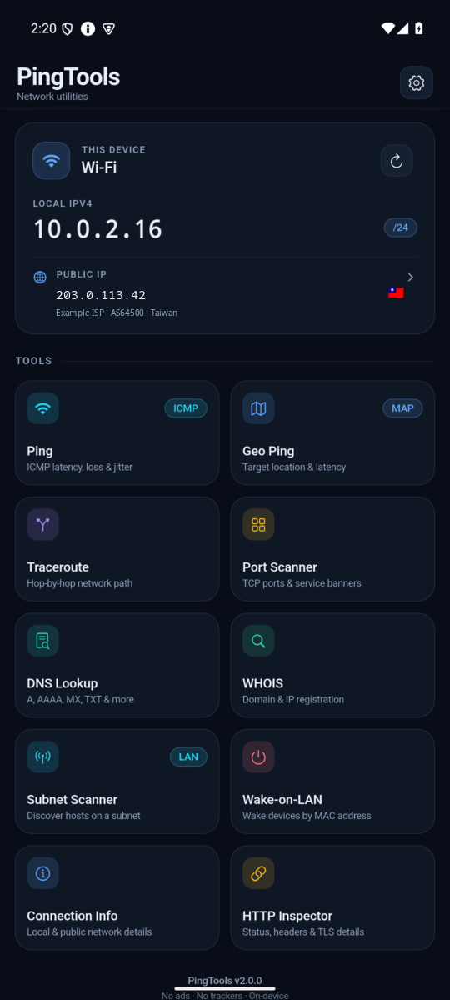
  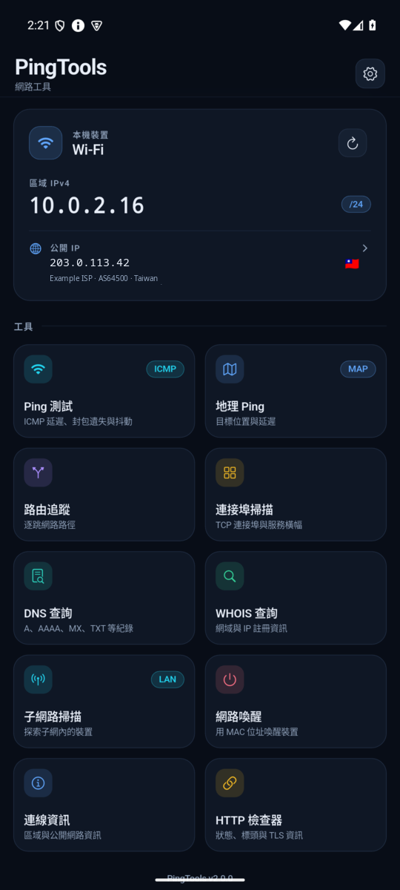
  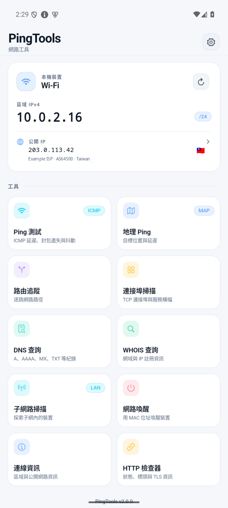
</p>
<p align="center">
  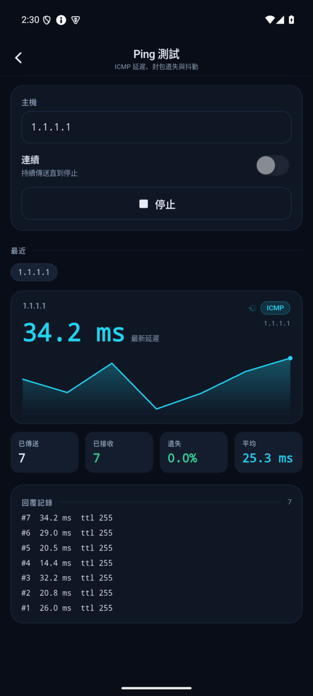
  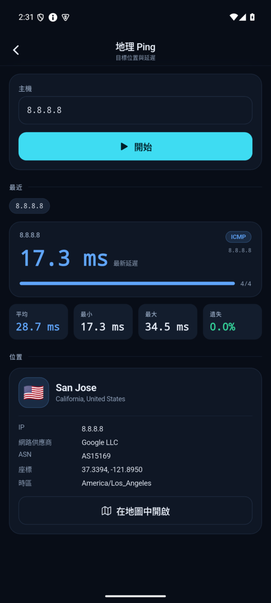
  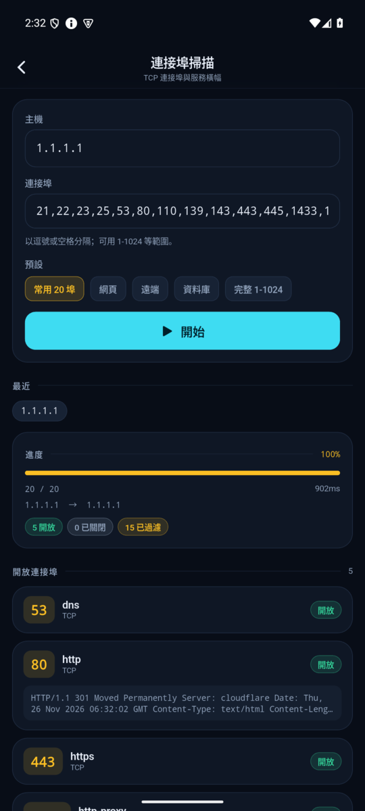
</p>
<p align="center">
  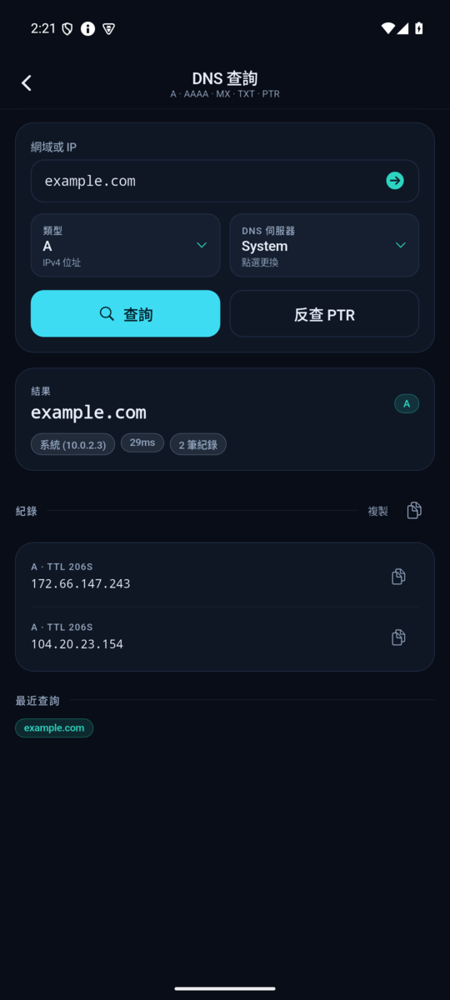
  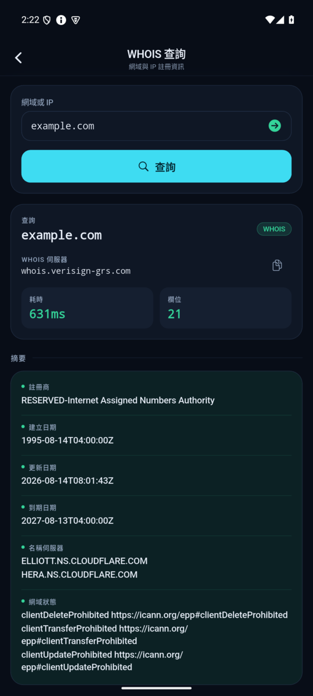
  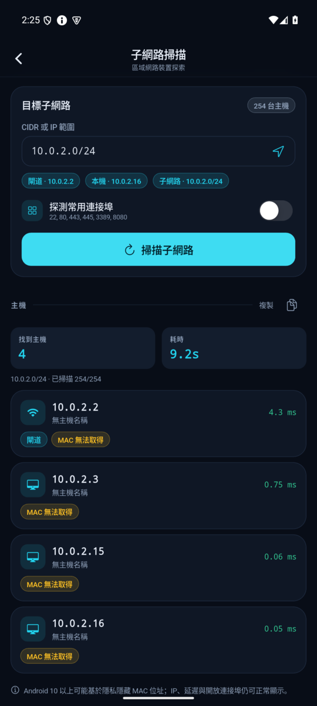
</p>
<p align="center">
  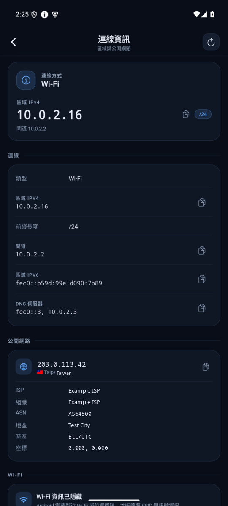
  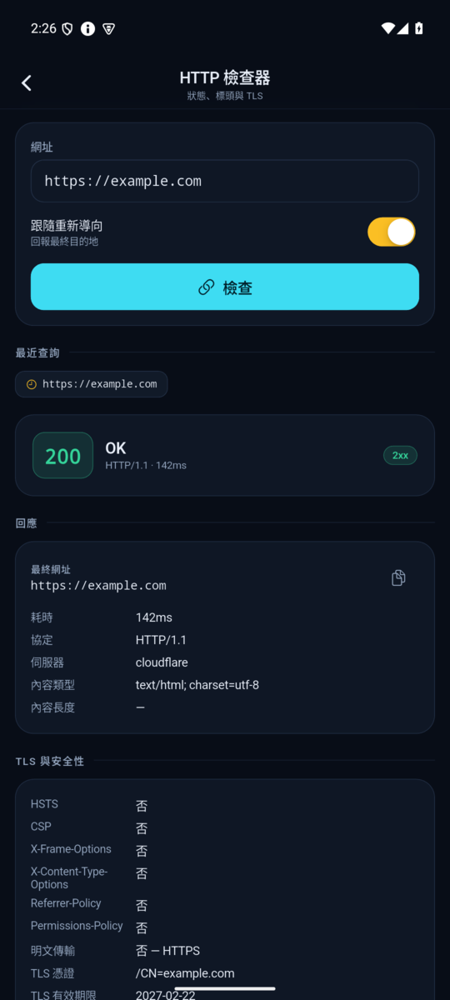
  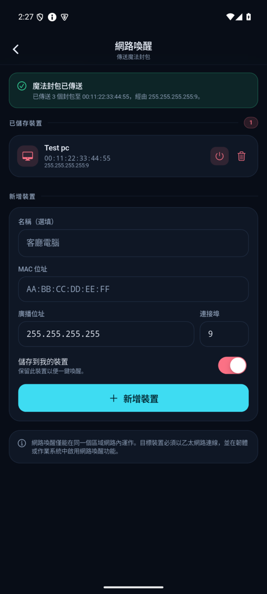
</p>

<sub>Android 15 emulator. Public IP, ISP and location fields are replaced with documentation values.</sub>

### In-app update

<p align="center">
  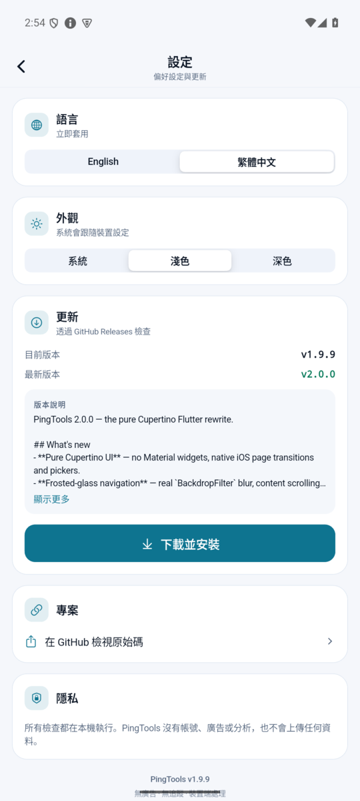
  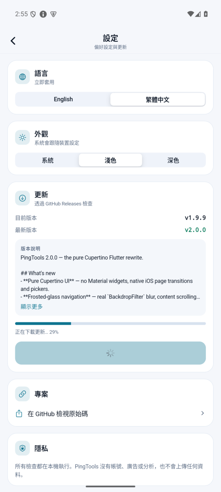
  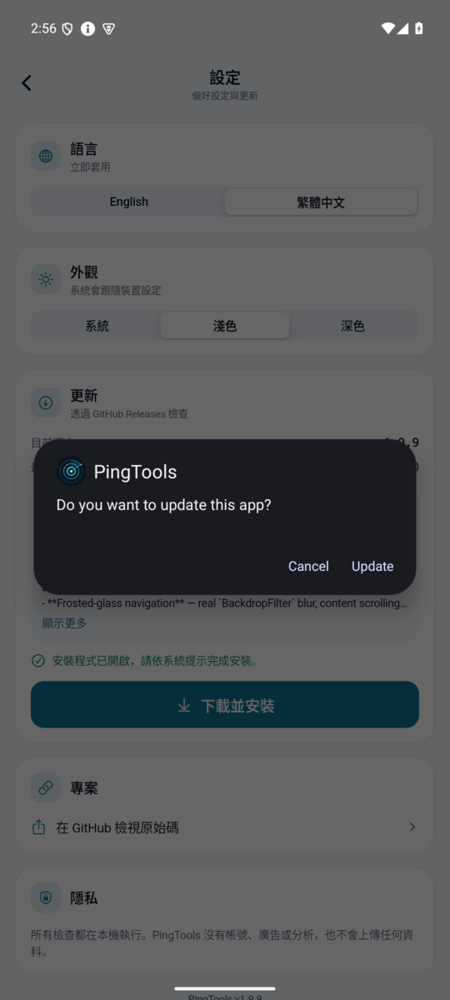
</p>

<p align="center"><sub>Verified end-to-end: a signed 1.9.9 build updates itself to 2.0.0 through the in-app updater.</sub></p>

## Tools

| Tool | What it does |
| --- | --- |
| **Ping** | Continuous or counted ICMP echo, live RTT sparkline, loss, jitter and standard deviation. Falls back to TCP-connect timing when Android blocks raw ICMP. |
| **Geo Ping** | Resolves a host, measures latency and shows city-level geolocation, ISP/ASN, coordinates and an “Open in Maps” link. |
| **Traceroute** | Hop-by-hop ICMP TTL discovery, three probes per hop. |
| **Port Scanner** | Concurrent TCP connect scan with presets, service names and banner grabbing. |
| **DNS Lookup** | A, AAAA, CNAME, MX, NS, TXT, SOA, SRV, CAA and PTR queries against the system resolver, Cloudflare, Google, Quad9, OpenDNS or AdGuard. |
| **WHOIS** | Port-43 client with TLD bootstrap, IANA referrals, highlighted registration fields and the raw record. |
| **Subnet Scanner** | Auto-detects the local subnet; scans any CIDR/range for live hosts, optionally probing common ports. |
| **Wake-on-LAN** | Saved devices, custom broadcast/port and optional SecureOn password. |
| **Connection Info** | Local IPv4/IPv6, prefix, gateway, DNS, Wi-Fi details and public IP with ISP/ASN/geo. |
| **HTTP Inspector** | Status, redirects, timing, protocol, TLS certificate, security headers and all response headers. |

## In-app update flow

1. The dashboard silently checks `api.github.com/repos/.../releases/latest`; Settings has a manual **Check now**.
2. A newer semantic version exposes the APK asset and release notes.
3. **Download & install** streams the APK to app-private storage and shows progress.
4. If a `.sha256` asset is published, the download is verified with `crypto` before installation.
5. `FileProvider` + `Intent.ACTION_VIEW` opens the Android package installer. On Android 8+ the app first offers to open the “install unknown apps” settings when needed.

The updater never installs silently and never downloads without a tap.

## Project layout

```
mobile/                     Flutter Cupertino app (v2, active)
├── lib/core/               models, settings, native bridge, network engines
├── lib/ui/                 Cupertino theme, widgets, screens
├── android/                Kotlin host: Wi-Fi info, permissions, APK installer
└── test/                   49 unit/widget tests

app/                        Native Kotlin + Jetpack Compose app (v1, preserved)
docs/                       architecture, screenshots, branding SVG
.github/workflows/          Flutter CI + native CI
```

## Build

### Flutter (v2)

Requires Flutter 3.50+ and Android SDK 36.

```bash
cd mobile
flutter pub get
flutter analyze
flutter test
flutter build apk --release
```

Release signing reads `mobile/android/key.properties` (git-ignored); start from `android/key.properties.example`. From the repo root, `./scripts/flutter-release.sh` builds, verifies the signature and writes the APK plus SHA-256 to `dist/`.

### Native (v1)

```bash
echo "sdk.dir=$ANDROID_HOME" > local.properties
./gradlew :app:assembleDebug
```

## Documentation

- [Flutter architecture](docs/FLUTTER_ARCHITECTURE.md)
- [Native v1 architecture](docs/ARCHITECTURE.md)
- [Changelog](CHANGELOG.md)
- [Privacy policy](PRIVACY.md)

## CI

- **Flutter CI** — `flutter analyze`, `flutter test`, debug APK build and artifact upload.
- **Native CI** — v1 unit tests and debug APK build.

## Permissions

| Permission | Why |
| --- | --- |
| `INTERNET`, `ACCESS_NETWORK_STATE` | All network tools and the update check. |
| `ACCESS_WIFI_STATE`, `CHANGE_WIFI_MULTICAST_STATE` | Wi-Fi link details and Wake-on-LAN broadcast. |
| `ACCESS_FINE_LOCATION`, `NEARBY_WIFI_DEVICES` | Android only reveals the connected SSID/BSSID with these permissions. Requested from the Connection screen, display-only. |
| `REQUEST_INSTALL_PACKAGES` | Only used when you choose to install an update; Android still requires the per-app “install unknown apps” toggle. |

## Notes & limitations

- Android may block raw ICMP depending on the kernel/`ping_group_range`; Ping falls back to TCP and says so. Traceroute requires ICMP.
- Android 10+ hides `/proc/net/arp`; subnet scans still find hosts, but MAC addresses may show as unavailable.
- Some carriers block ICMP or WHOIS port 43.
- The Dart HTTP client exposes TLS certificate details but not the negotiated TLS version/cipher; the inspector shows the certificate instead.
- HTTP inspection intentionally permits cleartext for URLs you enter; every automatic request the app makes (geo, updates, GitHub) is HTTPS.
- Use these tools only on devices and networks you own or are authorized to test.

## License

Apache License 2.0 — see [LICENSE](LICENSE). Privacy details: [PRIVACY.md](PRIVACY.md).

PingTools is an independent open-source project and is not affiliated with, endorsed by, or connected to any other app that uses a similar name.
