# PingTools — Network Utilities

A clean, fast, ad-free network toolbox for Android. Ten on-device tools, no account, no analytics, no backend.

**Download:** grab the signed APK from the [latest release](https://github.com/pinchiu/pingtools-network-utilities/releases/latest) (Android 7.0+).

<p align="center">
  
</p>

<p align="center">
  <a href="https://github.com/pinchiu/pingtools-network-utilities/actions/workflows/android.yml"></a>
  <a href="https://github.com/pinchiu/pingtools-network-utilities/releases/latest"></a>
  
  
  
</p>

## Tools

| Tool | What it does |
| --- | --- |
| **Ping** | Continuous or counted ICMP echo with live RTT chart, loss, jitter and standard deviation. Falls back to TCP-connect timing when Android blocks raw ICMP for apps. |
| **Geo Ping** | Resolves a host, measures latency and shows city-level geolocation, ISP/ASN and coordinates, with an “Open in Maps” link. |
| **Traceroute** | Hop-by-hop path discovery via ICMP TTL expiry, three probes per hop, reverse DNS for public hops. |
| **Port Scanner** | Concurrent TCP connect scan over custom ranges or presets, with service names and banner grabbing. |
| **DNS Lookup** | A, AAAA, CNAME, MX, NS, TXT, SOA, SRV, CAA and PTR queries against system, Cloudflare, Google, Quad9 or OpenDNS resolvers. |
| **WHOIS** | Port-43 WHOIS with IANA referral following, parsed key fields plus the full raw record. |
| **Subnet Scanner** | Auto-detects your subnet; scans any CIDR/range for live hosts, hostnames, MAC addresses and optionally common open ports. |
| **Wake-on-LAN** | Magic-packet sender with saved devices, custom broadcast address, port and optional SecureOn password. |
| **Connection Info** | Connection type, local IPv4/IPv6, gateway, DNS servers, Wi-Fi SSID/RSSI/link speed and public IP with ISP/ASN/geo. |
| **HTTP Inspector** | Status, redirect target, timing, protocol, TLS version/cipher, response headers and basic security checks. |

## Screenshots

<p align="center">
  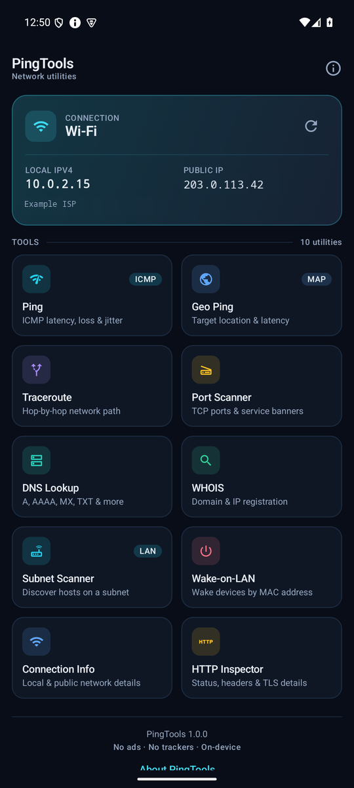
  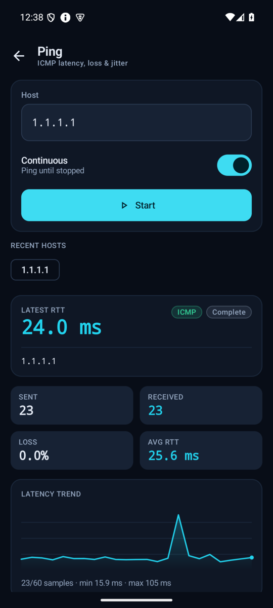
  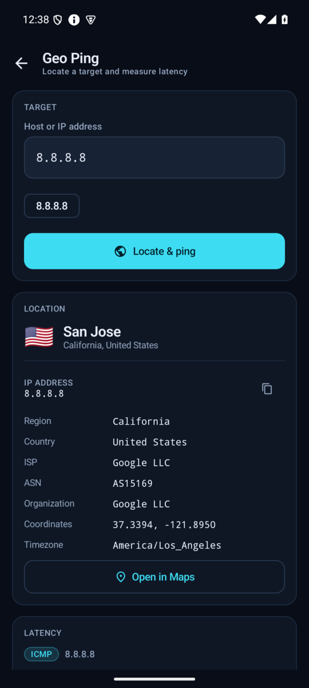
</p>
<p align="center">
  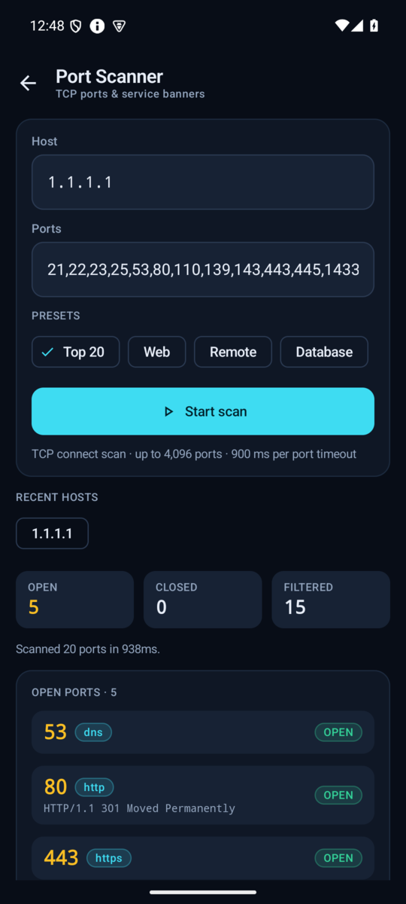
  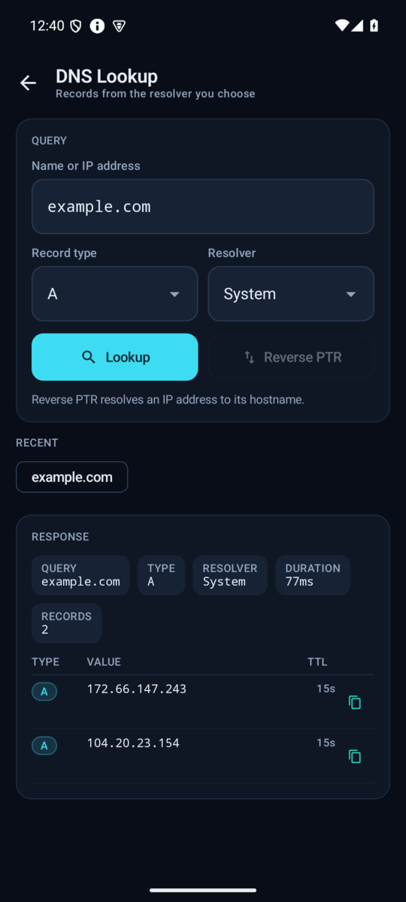
  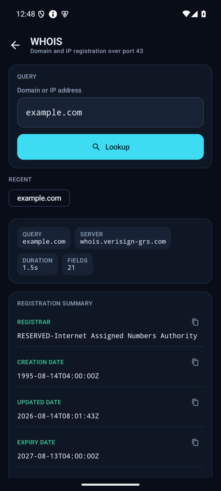
</p>
<p align="center">
  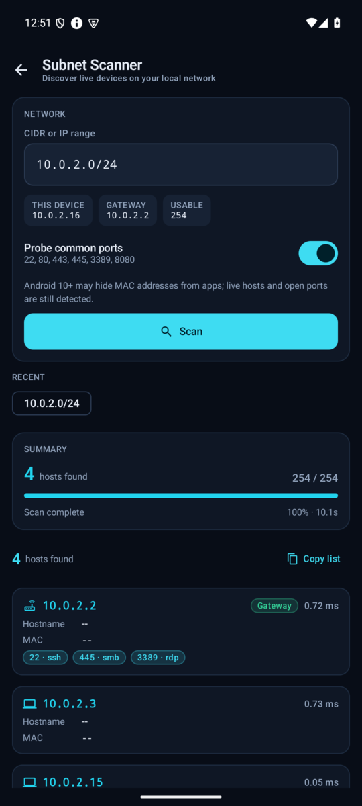
  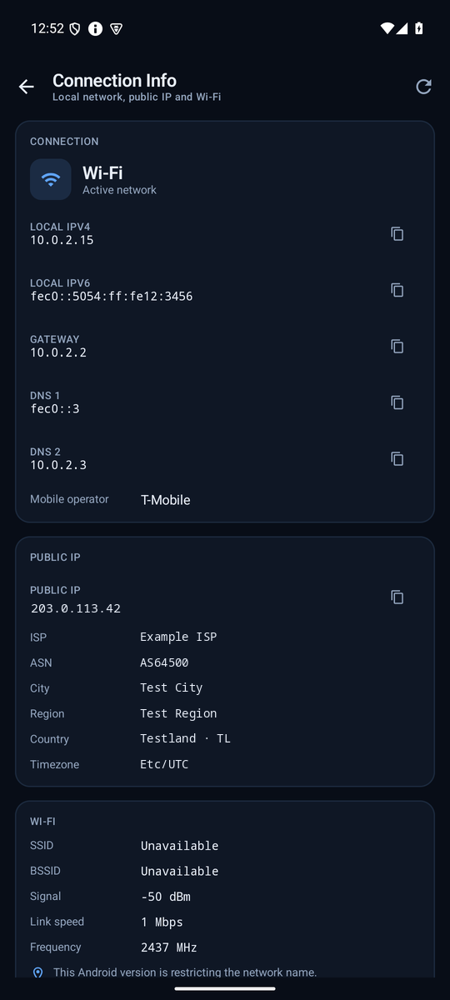
  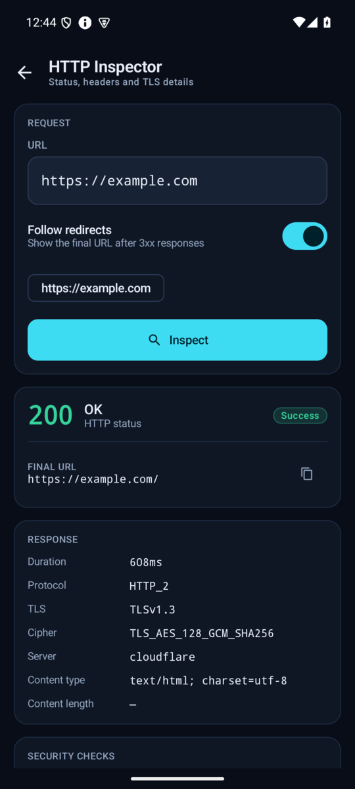
</p>
<p align="center">
  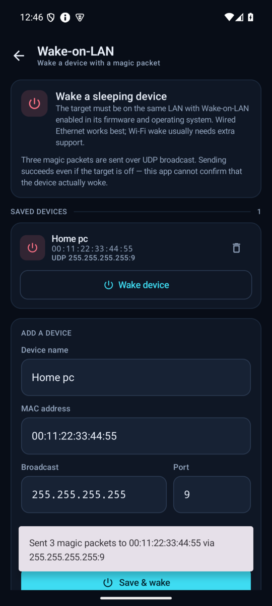
  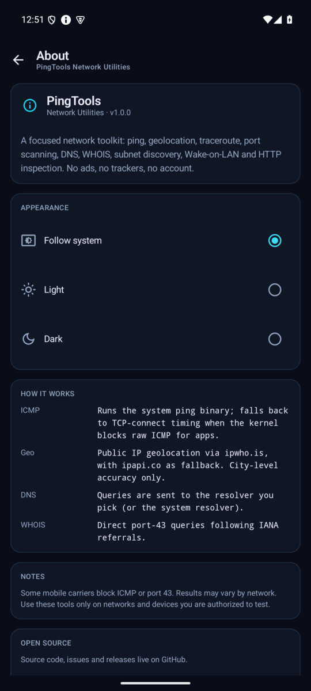
</p>

<sub>Screenshots from an Android 15 emulator. Public IP, ISP and location fields have been replaced with documentation values; other addresses are local emulator/host values.</sub>

## Design

- **Kotlin + Jetpack Compose + Material 3**, dark and light themes with a custom network-blue palette.
- **Single activity, single module**, feature-first packages under `ui/screens`, pure engines under `core/net`.
- **Streaming results** via Kotlin `Flow` — ping replies, traceroute hops and port scan progress render as they arrive.
- **No background services**, no wake locks, no ads, no third-party analytics. History is a small local `SharedPreferences` store.
- **Graceful degradation**: ICMP → TCP fallback, cleartext/TLS checks, permission-aware Wi-Fi details, explicit error states everywhere.

```
app/src/main/java/com/pinchiu/pingtools/
├── core/
│   ├── data/HistoryStore.kt        # recent inputs + saved WoL devices
│   ├── model/Models.kt             # shared events, configs, results
│   ├── net/                        # PingEngine, TracerouteEngine, PortScanner,
│   │                               # SubnetScanner, WolEngine, DnsEngine,
│   │                               # WhoisEngine, IpInfoEngine, HttpEngine
│   └── util/                       # process runner, parsing and formatting
├── ui/
│   ├── components/Components.kt    # shared Compose building blocks
│   ├── screens/                    # one file per tool + Home/About
│   ├── theme/                      # color, type, theme store
│   ├── AppNav.kt                   # navigation graph
│   └── ToolRegistry.kt             # tool metadata
└── MainActivity.kt
```

## Documentation

- [Architecture and engine contracts](docs/ARCHITECTURE.md)
- [Changelog](CHANGELOG.md)
- [Privacy policy](PRIVACY.md)

## Build

Requirements: JDK 17+, Android SDK 36 (build-tools 36), Gradle wrapper included.

```bash
git clone https://github.com/pinchiu/pingtools-network-utilities.git
cd pingtools-network-utilities
echo "sdk.dir=$ANDROID_HOME" > local.properties
./gradlew :app:assembleDebug
# APK → app/build/outputs/apk/debug/app-debug.apk
```

CI (`.github/workflows/android.yml`) builds the debug APK and runs unit tests on every push.

## Permissions

| Permission | Why |
| --- | --- |
| `INTERNET`, `ACCESS_NETWORK_STATE` | All network tools, public IP lookup, HTTP inspection. |
| `ACCESS_WIFI_STATE`, `CHANGE_WIFI_MULTICAST_STATE` | Wi-Fi link details and Wake-on-LAN broadcast. |
| `ACCESS_FINE_LOCATION`, `NEARBY_WIFI_DEVICES` | Android only exposes the connected Wi-Fi SSID/BSSID to apps with location/nearby-Wi-Fi permission. Requested at runtime, used for display only. |

## Notes & limitations

- Android may deny raw ICMP sockets to unprivileged apps depending on the device kernel. Ping automatically falls back to TCP latency and says so; traceroute requires ICMP and will report when unavailable.
- Android 10+ blocks unprivileged access to `/proc/net/arp` and `/proc/net/route`. Subnet scans still discover live hosts, but MAC addresses may be unavailable and the gateway is resolved through `LinkProperties` instead.
- Many carriers block port 43 (WHOIS) and ICMP. Results depend on the network you are on.
- Public-IP geolocation is city-level and provided by [ipwho.is](https://ipwho.is) with [ipapi.co](https://ipapi.co) as fallback.
- Use these tools only on devices and networks you own or are authorized to test.

## License

Apache License 2.0 — see [LICENSE](LICENSE). Privacy details: [PRIVACY.md](PRIVACY.md).

PingTools is an independent open-source project and is not affiliated with, endorsed by, or connected to any other app that uses a similar name.
